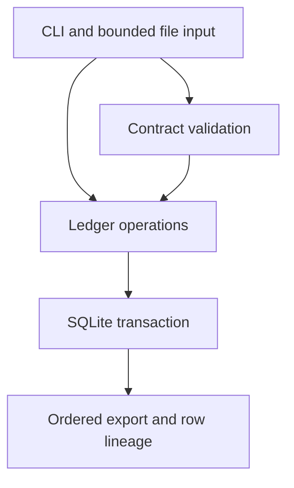

# Architecture
The system keeps intake decisions and the evidence behind them in a single local database.

## Components and data flow

- contracts.py parses strict JSON and validates a small flat-field contract language.
- ledger.py owns persistence, retry identity, replay, and batch quality decisions.
- cli.py maps command arguments, local files, results, and domain failures.
- schema.sql is the initial migration. application_id identifies IntakeLedger and user_version identifies migration 1.

## Transaction boundaries
Ingest first snapshots at most 8 MiB of source bytes. It checks transport limits and UTF-8 before preparing all row results. Only then does BEGIN IMMEDIATE acquire the writer lock. A source/key lookup, batch insert, and every row insert commit together. Equivalent retries return the existing batch. Changed retry identity raises a conflict before insertion.

The request digest includes original source hash, canonical contract hash, exact rational threshold, and replay parent. The source is part of the unique database key. There is no global deduplication across distinct sources or keys.

SQLite rolls back failures and interrupted transactions. The context manager catches BaseException so KeyboardInterrupt also rolls back. Abrupt process death relies on SQLite journal recovery. No network sink participates in the transaction.

Reads return bounded batches. Multiple method calls are separate database snapshots. Application code never updates recorded contracts, batches, or rows. Direct database access remains capable of changing them.

## Lineage and replay
A row hash covers UTF-8 row bytes excluding LF or CRLF line endings. The source hash covers all original bytes, including line endings. Physical blank lines are invalid rows, not skipped rows. U+2028 inside JSON strings is data, not a row separator. BOM is not stripped.

Replay reads every original row and validates against a registered contract. The new batch points to its parent and shares original source identity and row hashes. Replaying every row is necessary because a new contract can tighten as well as relax validation. A parent is never edited.

## Gates and errors
The fraction of invalid rows is compared to the permitted threshold using Fraction, including equality. Rejection persists all validation results but blocks the entire batch from export. A committed batch may have zero exportable rows if the operator explicitly permits a threshold of 1.

IntakeError carries a stable code and a payload-free message. Database busy errors are retryable. Invalid transport input creates no batch. Schema mismatches fail before migration. Health checks SQLite structural integrity and foreign keys, not cryptographic authenticity.

## Security and tradeoffs
Parameterized SQL handles labels. Contract fields never become SQL identifiers. No eval, subprocess, plugin execution, or external connections exist in the runtime package. Source text stays in the database unless an operator requests payload rows or accepted export. File permissions, disk encryption, backups, and retention belong to the operator.

This is a bounded batch engine, not a distributed ingestion service. One writer and brief read operations fit its local use case. See the decision record and threat model for residual risks.

## Version 0.2 pipeline extension
The legacy intake interfaces are retained. pipeline.py validates bounded dependency graphs,
owns persisted executions, fail-fast stage progression, generation-fenced recovery and ordered
backfill coordinators. quality.py supplies reusable uniqueness, reference, group-consistency
and comparison rules. Schema checks run before quality rules. migration_2.sql adds execution,
stage, event, origin and edge tables and seeds old replay history. It is applied atomically
when a recognized v1 ledger opens. Back up before upgrade; downgrade is unsupported.

Each stage completion and output batch share the same ledger writer transaction. The ledger's
internal batch writer accepts the stage transaction for this composition; ordinary ingestion
still owns its own transaction. Completed stages survive later failures; failed-stage output
cannot survive a rolled-back checkpoint. Rejected quality decisions remain inspectable.

Execution keys fingerprint the whole canonical plan and ordered inputs. Explicit resume
increments a generation to fence older workers at transaction boundaries. No automatic lease
takeover exists. Batch origins connect outputs to executions/stages; typed ancestry edges
include reference dependencies. Insert cycles and edge updates are rejected by SQL triggers.
See PIPELINES.md for state transitions, rule semantics, CLI and limits, and ADR 0002 for tradeoffs.

## Version 0.2.1 operational inspection and release guards
Quality summaries read the existing immutable batch/row evidence and count invalid
rows independently from issue occurrences. Rejection still blocks every otherwise
valid row. No new persistence or migration is required. Timestamped execution logs
expose terminal success/failure context using safe codes; the database's execution
and event records remain authoritative. Offline lock/input/build-pin validation and
explicit CI gate checks are development boundaries, not runtime dependencies.
Verifier launch/time-limit failures are persisted as failed evidence; an older green
report is not a valid substitute for a completed run. See the extended audit and
current remediation report for scope, tests and environmental limits.
